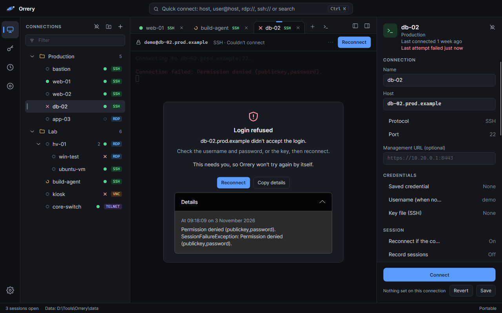

<p align="center">
  
</p>

<h1 align="center">Orrery</h1>

<p align="center">
  A remote connection manager for Windows, Linux and macOS.<br>
  RDP, SSH, VNC, Telnet and serial consoles in one tree, opened in tabs, with passwords kept in your system's own secret store.
</p>

<p align="center">
  
  
  
  
</p>

<p align="center">
  
</p>

| Runs on | Passwords | Accessibility | Imports |
| --- | --- | --- | --- |
| Windows, Linux and macOS, installed or portable | In Credential Manager, the macOS Keychain or the Secret Service, or an encrypted vault file | Works with Narrator, NVDA and JAWS, and adjusts its colors for color blindness | mRemoteNG `confCons.xml`, Remote Desktop `.rdp` files and OpenSSH `~/.ssh/config` |

Orrery is built on Avalonia and .NET 10. It takes its cue from [mRemoteNG](https://mremoteng.org/) and can import
mRemoteNG's `confCons.xml`, but it isn't affiliated with the mRemoteNG project.

> This is version 0.1.0. The protocols work, but a fair amount hasn't been tried on real machines yet; see
> [Status](#status).

**Contents:** [Features](#features) · [Accessibility](#accessibility) · [Keyboard shortcuts](#keyboard-shortcuts) ·
[Where your data lives](#where-your-data-lives) · [Building](#building) · [Status](#status) ·
[License and credits](#license-and-credits)

## Features

### Protocols

| Protocol | Library | Notes |
| --- | --- | --- |
| RDP | [IronRDP](https://github.com/Devolutions/IronRDP) | Fits the window and follows it as you resize, or keeps a fixed size; sound; shared drives and folders; full screen over every display (Windows); the console session; touch and pen; follows RD Connection Broker redirections; opens `.rdp` files |
| SSH | [SSH.NET](https://github.com/sshnet/SSH.NET) | Port forwards (`L`, `R`, `D`), a SOCKS proxy for a whole folder, key files, agent keys, a keep-alive interval, and an SFTP browser |
| VNC | [MarcusW.VncClient](https://github.com/MarcusWichelmann/MarcusW.VncClient) | Text clipboard, view only, shrink to fit, fill the tab or actual size |
| Telnet | Built in | |
| Serial | [System.IO.Ports](https://www.nuget.org/packages/System.IO.Ports) | A terminal on a COM port or `/dev/tty*` device, with its speed, data bits, parity, stop bits and flow control |
| Web (HTTP, HTTPS) | Your browser | Opens in your default browser rather than a tab, so a router's or a server's admin page sits in the tree with the rest |
| Local terminal | Built in | PowerShell, cmd or a WSL distribution on Windows; your login shell on Linux and macOS |

### Connecting

<p align="center">
  
</p>

Quick connect (Ctrl+K) searches your saved connections and open sessions as you type, and can connect straight to a
host you type in.

- Jump hosts work for every protocol, like `ssh -J`. RDP, VNC and Telnet go through an SSH tunnel. A web page can't,
  since your browser wouldn't go through it; give the jump host a SOCKS proxy and point the browser at that instead.
- A folder can give every SSH connection under it a SOCKS proxy, as if each had its own `D 1080` forward, and set how
  often SSH sends keep-alives (every 30 seconds unless you change it; 0 sends none).
- Quick connect takes `https://router.lan/admin` and `http://` addresses, which open in your browser, and serial
  ports: `COM3`, `/dev/ttyUSB0` or `serial://` followed by the port's name.
- Open a Remote Desktop (`.rdp`) file from the tree's right-click menu, or start Orrery with one
  (`Orrery path/to/server.rdp`), to connect without saving it. Import adds it to the tree. A password saved in the
  file isn't imported, because Windows encrypts it for one user on one computer; Orrery asks for it instead. If
  Orrery is already running, a second start says so and the file isn't opened; use Open in the running window.
- Ctrl+Alt+End sends Ctrl+Alt+Del to a remote desktop (Ctrl+Cmd+End on macOS), since Windows keeps the real one for
  itself. The session's Send keys menu has it and the other keys a remote desktop may need, and View only stops
  sending your keys and clicks.
- RDP passes on touch and pen input, with pressure, tilt and the eraser, when the server takes it.
- A remote desktop's sound plays here unless you turn it off, and then the server isn't asked to send any.
- RDP can share every drive of this computer, or folders you choose, as drives on the remote computer, which can read
  and change their files. Linux and macOS can share only one folder: your home folder when sharing every drive, else
  the first folder you chose. Orrery says so when a folder isn't shared.
- On Windows, full screen can spread a remote desktop over every display, one remote monitor for each, when the
  displays sit against each other. Otherwise full screen stays on one display and says why.
- RDP can join the server's console session, as `mstsc /admin` does.
- When an RD Connection Broker sends a connection on to another session host, Orrery follows it, up to five times,
  and sends back the broker's routing token so it reaches the right session.
- A connection, or a whole folder, can point at an SSH key file on your computer. Orrery tries a saved key first,
  then the key file, then your SSH agent, then the password. It reads the file each time you connect and never copies
  it. If the key has a passphrase, Orrery asks for it and can save it. On Linux and macOS it warns you when other
  users can read the key.
- The SFTP browser sits beside the terminal. You can upload or drop files in, download, rename, delete and make
  folders.
- The clipboard is shared unless you turn it off for a connection or folder. Over RDP on Windows it carries text,
  images and files. Over RDP on Linux and macOS, and over VNC, it carries text.
- When a connection fails or drops, the tab says in plain words what happened and what to try. Enter reconnects, and
  the technical details are a click away, with a button to copy them.
- After a drop, Orrery reconnects on its own, waiting a little longer each time (up to a minute), and right away
  when the network comes back. It never retries a refused login or an untrusted host key or certificate, since those
  need you.
- Give a connection a MAC address and you can wake its machine from the right-click menu (Wake-on-LAN).

<p align="center">
  
</p>

### Organizing

- Connections live in a tree with folders, drag and drop, multi-select and a filter, and inherit settings from
  their folders.
- Host groups put a host's guest machines underneath it.
- Every row has two marks. The one before the name is the session: a filled dot when connected, a broken ring while
  connecting, a cross when it failed, and an empty ring when nothing is open. The one beside the protocol is the
  host: a filled dot when it answered, a cross when it didn't, and a dashed ring when it can't be checked. Hover over
  either to read it in words.
- Hosts are checked about once a minute, only for connections you can see and never through a jump host. The check
  is a plain TCP connect by default, which some networks treat as a port scan. Settings can switch it to ping or turn
  it off. Firewalls often block ping, so a host that's up can show as down, and where this computer isn't allowed to
  ping, hosts show the dashed ring. A serial port isn't checked, and a web page is checked at its host and port.
- The properties pane shows when a connection last connected ("Last connected 3 days ago", with the exact time on
  hover), and when the last attempt failed, if that was more recent.

### Credentials, import and export

- Passwords go in Windows Credential Manager, the macOS Keychain or the Linux Secret Service.
- With no system store, or if you'd rather, they go in an encrypted vault file (Argon2id, XChaCha20-Poly1305).
- Windows Hello can unlock the vault when Windows reports that its key is held in the TPM (not over Remote Desktop).
  Touch ID on macOS is written but needs a signed build. See [the design notes](docs/design-biometric-unlock.md).
- Orrery imports mRemoteNG `confCons.xml`, Orrery `.json`, Remote Desktop `.rdp` files, and your OpenSSH `~/.ssh/config`, including `Include`
  files, `Host *` defaults, and `ProxyJump` chains, which become jump hosts. Nothing in an SSH config is run, and the
  import never opens key files.
- It exports Orrery `.json`, mRemoteNG `confCons.xml` or CSV. Passwords are encrypted under a password you choose,
  and CSV never gets them. mRemoteNG has no serial connections, so those are left out of a `confCons.xml`, and the
  export says so.
- The credential editor hides a private key until you press Show, and you can still paste into the box.

### Display and color

- Display quality can be set per connection or folder: Balanced, Best look or Fastest.
- *Enlarge to match display scaling* helps on high-DPI screens.
- Interface colors come in three sets: Standard, Clearer (easier to tell apart for most kinds of color blindness),
  and Color-blind (the Okabe-Ito palette). The terminal has its own color-blind friendly scheme.
- Under *Color vision* you can say whether you have protanopia, deuteranopia or tritanopia. Orrery then uses the
  color-blind colors, tunes the terminal's colors to match, and adjusts RDP and VNC desktops so colors you'd confuse
  look different, at a strength you pick. A connection or folder can turn that correction off, for design or photo
  work.
- Session states, host status, warnings and errors each have a shape, an icon or a word as well as a color.

<p align="center">
  
</p>

HDR isn't possible over RDP or VNC. RDP can't follow your display scaling yet, because IronRDP's .NET binding doesn't
pass it on; *Enlarge to match display scaling* enlarges the picture on your side instead.

### Your workspace

- Install it, or run it portable with its data wherever you choose.
- Orrery remembers the window and your open tabs, and can reopen them at the next start: ask, always, or never. A
  host typed into quick connect comes back by address only and asks for its login again. Choosing never also stops
  the tab list being saved and deletes the one already saved; the window's size, position and panes are still
  remembered.
- Turning off *Remember recent connections* deletes the Recent list and the last connected times, and Orrery records
  nothing more until you turn it back on.
- The interface is dark first.

## Accessibility

Orrery aims to work with a screen reader, from the keyboard, and with color blindness. Some gaps remain; they're
listed at the end of this section.

### Screen readers

Orrery works with Narrator, NVDA and JAWS on Windows.

- Every button, field and list says what it is.
- Each row in the connection tree gives its name, what it is (protocol and host, or how many connections a folder
  holds), the state of its session, and whether its host is up when host checks are on.
- Session tabs say which connection they are, its state, and which tab is current.
- When a connection fails or drops, you hear what happened and the focus moves to Reconnect.
- When Orrery asks whether to trust a new host key or certificate, the prompt takes the focus and is read out.
- A terminal reads new output a few lines at a time once it pauses, without echoing what you type. This is on while
  a screen reader is running; change it under Settings › Appearance › Accessibility. A screen reader can also read
  the whole terminal screen and the cursor's line and column.
- Password fields give a screen reader a dot per character, never the password. The private key box says only
  "Private key, 3 lines", whether or not the key is showing.

### Keyboard

- Terminals and remote desktops keep every key, Tab included.
- Ctrl+Alt+Home (Ctrl+Cmd+Home on macOS) leaves the session for its tab, leaving full screen first. Enter on the tab
  takes you back in.
- In a terminal, Ctrl+Shift+A selects everything, and plain Ctrl+A still goes to the remote shell.

### Color

- The Clearer and Color-blind interface colors, the color-blind terminal scheme and remote desktop correction are
  described under [Display and color](#display-and-color).
- The tests check every color that carries meaning against simulated protanopia, deuteranopia and tritanopia
  (Machado et al. 2009) for how far apart the colors look (CIEDE2000), and against WCAG contrast.

<p align="center">
  
</p>

### Not there yet

- A remote desktop is a picture, so a screen reader can only tell you "Remote desktop:" and the connection's name.
- Remote desktop color correction makes confusable colors differ, but it can't show you colors you can't see, and it
  changes how pictures look. It's been checked by numbers, not yet by color-blind people.
- Avalonia, the toolkit Orrery is built on, doesn't let screen readers move through a terminal by line or word yet,
  so they get the screen as one block of text.
- Tree rows don't report their level or "2 of 5". Password fields aren't marked as password fields, so a screen
  reader that echoes typed characters will read a password out as you type it. Turn that echo off while you type
  one.
- VoiceOver on macOS hasn't been tested. On Linux, Avalonia has no screen reader support yet, so Orca can't read
  Orrery.

## Keyboard shortcuts

On macOS, Cmd takes the place of Ctrl.

| Keys | Action |
| --- | --- |
| Ctrl+K | Quick connect |
| Ctrl+Shift+T | Local terminal |
| Ctrl+Shift+A, Ctrl+Shift+C, Ctrl+Shift+V (Cmd+A, Cmd+C, Cmd+V on macOS) | In a terminal: select all, copy, paste |
| Ctrl+, | Settings |
| Ctrl+B | Show or hide the side panel |
| Ctrl+Alt+B | Show or hide the properties pane |
| Ctrl+Alt+Enter (Ctrl+Cmd+F on macOS) | Full screen (you can change this in Settings) |
| Ctrl+Alt+Home (Ctrl+Cmd+Home on macOS) | Leave the session for its tab; Enter goes back in |
| Ctrl+Alt+End (Ctrl+Cmd+End on macOS) | In a remote desktop: send Ctrl+Alt+Del |
| Enter | Connect the selected connections |
| F2 | Rename |
| Ctrl+D | Duplicate |
| Delete | Delete the selected rows |

While a remote session has focus, it gets keys first, so these go to the remote machine. Full screen,
Ctrl+Alt+Home and Ctrl+Alt+End always reach Orrery. Ctrl+Shift+T still opens a local terminal from inside a terminal, but not from a
remote desktop.

## Where your data lives

A portable copy has an `orrery.portable.json` file beside the executable, and asks on first launch where to keep
its data. An installed copy uses the usual folder for each system.

<details>
<summary>Data folders for an installed copy</summary>

| | Installed copy |
| --- | --- |
| Windows | `%APPDATA%\Orrery` (cache and logs in `%LOCALAPPDATA%\Orrery`) |
| macOS | `~/Library/Application Support/Orrery` |
| Linux | `~/.config/orrery` (XDG directories are respected), for the .deb, .rpm and AppImage |

</details>

When each connection last connected or failed is kept in `history.json`, by connection, so it survives renames and
moves. It stays on this computer: exports don't carry it, and deleting a connection deletes its entry.

<details>
<summary>Logs</summary>

Logs record what connected where and what went wrong, one file a day, kept for two weeks, in
`%LOCALAPPDATA%\Orrery\Logs`, `~/Library/Logs/Orrery` or `~/.local/state/orrery/logs` (a portable copy keeps them in
its data folder). They never hold passwords, keys, keystrokes or anything that was on screen. Settings has a button
to open the folder, and a detailed logging switch for troubleshooting that turns itself off when Orrery closes.

</details>

## Building

You need the [.NET 10 SDK](https://dotnet.microsoft.com/download) and PowerShell (Windows PowerShell 5.1 is fine, or
[PowerShell 7](https://github.com/PowerShell/PowerShell) on Linux and macOS). From the repo root, fetch the IronRDP
package once (see below), then build:

```powershell
./build/Get-IronRdp.ps1
dotnet build Orrery.sln
dotnet test Orrery.sln
dotnet run --project src/Orrery.App
```

### The IronRDP package

The RDP clipboard on Linux and macOS, sound, shared drives, the console session, spreading over displays and a
broker's routing token need changes to IronRDP's .NET binding that haven't been released yet. Until they are, Orrery builds with a `Devolutions.IronRdp` made from a fork of IronRDP, at the version set in
`Directory.Build.props` (`IronRdpVersion`). It isn't on nuget.org. `nuget.config` looks for it in `.nuget-local`, a
folder in the repo that git ignores, and `build/Get-IronRdp.ps1` downloads it there from this repo's releases. It
checks the file against the SHA-256 in `build/ironrdp-package.json` and won't use a file that doesn't match. If a
restore fails with NU1301 or NU1101 for the `ironrdp-local` source, the script hasn't been run yet.

You only need to run it again when `IronRdpVersion` changes.

<details>
<summary>Using a package you built, or going back to the released one</summary>

To use a package you built yourself, pass the folder
holding it and its SHA-256: `./build/Get-IronRdp.ps1 -FromFolder <folder> -Sha256 <hash>`. Its content hash differs
from the one in the lock files, so the packaging scripts' locked restores fail with it until
`./build/Update-IronRdpLockHashes.ps1` updates that hash (it checks that nothing else in the lock files changed).
The published package is built for all six platforms and released by the IronRDP fork's own workflow (see
[docs/packaging.md](docs/packaging.md)).

To go back to the released package, remove the `ironrdp-local` source and its mapping from `nuget.config`, set
`IronRdpVersion` back to `2026.10.29`, and run `dotnet restore Orrery.sln --force-evaluate` to update the lock files.

</details>

### Packages

To build everything this machine can:

```powershell
./build/Build-All.ps1
```

It runs the scripts below in turn. If a tool is missing, it skips that step with a warning and carries on, then lists
what it built and what it didn't. On Windows you get everything except the AppImage. Pass `-NfpmPath` or `-IsccPath`
for tools that aren't on PATH, and `-SkipPortable`, `-SkipInstaller` or `-SkipLinux` to leave a step out.

<details>
<summary>What each script builds, and what it needs</summary>

| Script | Builds | Needs |
| --- | --- | --- |
| `./build/package.ps1` | Portable zips for win-x64, win-arm64, linux-x64, linux-arm64, macos-arm64 and macos-x64 (`-Runtimes win-x64` for just one; .NET calls the Mac ones `osx-arm64` and `osx-x64`) | .NET SDK |
| `build\Build-Installer.ps1` | Windows installer | Windows, [Inno Setup](https://jrsoftware.org/isinfo.php) 7 |
| `./build/Build-LinuxPackages.ps1` | .deb and .rpm, x64 and arm64 | [nfpm](https://nfpm.goreleaser.com/install/) (runs on Windows too) |
| | AppImage, x64 and arm64 | Linux, [appimagetool](https://github.com/AppImage/appimagetool/releases) |

</details>

Packages are self-contained, so the target machine doesn't need .NET installed. Output goes to `artifacts/`. On
Windows and Linux the portable app is a single executable, which unpacks its native libraries to a cache folder the
first time it runs. On macOS it's an `Orrery.app` bundle, not yet signed or notarized. On Linux, run
`chmod +x Orrery` after unzipping a portable zip; the machine needs X11 (or XWayland), fontconfig and ICU, which the
.deb and .rpm list as dependencies. There's no Flatpak.

GitHub Actions builds all of these on every push and pull request. [docs/packaging.md](docs/packaging.md) has the
details, including Linux requirements, third-party notices, lock files and the workflow.

### Screenshots

The screenshots in this README are drawn from made-up data by `tools/Orrery.Screenshots`.
`dotnet run --project tools/Orrery.Screenshots` makes them again; [docs/screenshots.md](docs/screenshots.md) explains
how.

### Repository layout

<details>
<summary>What's in each folder</summary>

| Path | What's in it |
| --- | --- |
| `src/Orrery.App` | The Avalonia app: windows, connection tree, properties pane, settings |
| `src/Orrery.Core` | Model, storage, credentials, vault, import and export |
| `src/Orrery.Protocols.*` | RDP, SSH, VNC, Telnet and serial sessions, and local terminals |
| `tests/` | xUnit tests, including headless Avalonia UI tests |
| `tools/Orrery.Screenshots` | Draws the README's screenshots from made-up data |
| `build/` | Packaging, installer and third-party notice scripts |
| `installer/` | Inno Setup script for the Windows installer; `installer/linux/` has the Linux launcher and icons |
| `docs/` | Design notes, the packaging guide, and the README's images in `docs/images` |
| `.github/` | The GitHub Actions workflow that builds the packages |

</details>

## Status

On Windows, RDP resizing, the clipboard and the installer all work. That includes the text-only RDP clipboard that
Linux and macOS use, tested against a Windows Server 2019 machine.

Not yet checked on real machines:

- The Linux and macOS builds, including the .deb, .rpm and AppImage, and the ARM builds
- Local terminals on Linux and macOS
- The RDP clipboard on Linux and macOS
- VNC authentication
- Logging in to a real SSH server with a key file, plain and with a passphrase, directly, in the file browser and
  through a jump host
- How each protocol reports real network failures on the connection-lost screen (an RDP server refusing a login,
  especially)
- The Windows Hello and Touch ID prompts
- RDP touch and pen input
- Following an RD Connection Broker's redirection and sending its routing token back (tested against made-up
  redirections, not a real farm)
- RDP sound, shared drives and folders, and the console session
- Full screen over several displays, especially displays with different scaling
- A serial console on real hardware (tested against a stand-in port)
- The SSH keep-alive interval and a folder's SOCKS proxy against a real server
- Remote Desktop files saved by Remote Desktop Connection itself (tested against files written to match its format)

RDP sound, shared drives, the console session, spreading over displays and the routing token need IronRDP
`2026.10.29-orrery.3` or later, with a native library built from the same commit. Where the package's library for a
platform is older, as a package built on one machine has for the others, Orrery connects without them and logs which
it left out.

The Windows executables aren't code-signed, so SmartScreen may warn on first launch, and antivirus tools can flag the
single-file executable as a false positive.

## License and credits

Orrery is MIT-licensed, © 2026 InspireNXE. See [LICENSE](LICENSE).

It's built on open-source work, all under permissive licenses (MIT, Apache 2.0, BSD, ISC, OFL):

- [Avalonia](https://avaloniaui.net/) (UI), [SkiaSharp](https://github.com/mono/SkiaSharp) and
  [HarfBuzzSharp](https://github.com/mono/SkiaSharp) (drawing and text), and the [Inter](https://rsms.me/inter/) font
- [IronRDP](https://github.com/Devolutions/IronRDP) by Devolutions (RDP), [SSH.NET](https://github.com/sshnet/SSH.NET)
  (SSH), [MarcusW.VncClient](https://github.com/MarcusWichelmann/MarcusW.VncClient) (VNC, through the
  [community fork](https://github.com/karbonbaron/MarcusW.VncClient))
- [NSec](https://nsec.rocks/) and [libsodium](https://libsodium.org/) (vault and export encryption),
  [BouncyCastle](https://www.bouncycastle.org/) (mRemoteNG file encryption)
- [.NET](https://dotnet.microsoft.com/) by Microsoft and the .NET Foundation, which ships inside every package
- Portions of this software are copyright © The FreeType Project (https://freetype.org). All rights reserved.
  (FreeType is built into Skia.)

Every package carries `THIRD-PARTY-NOTICES.txt`, generated from what that build ships, with each component's license
and copyright notices. The AppImage also carries `APPIMAGE-RUNTIME-NOTICES.txt` for the AppImage runtime and the
libraries linked into it, including libfuse (LGPL 2.1).

mRemoteNG is GPL-licensed. Orrery reads and writes its `confCons.xml` files using code written from the file format
alone, and contains none of mRemoteNG's code.
