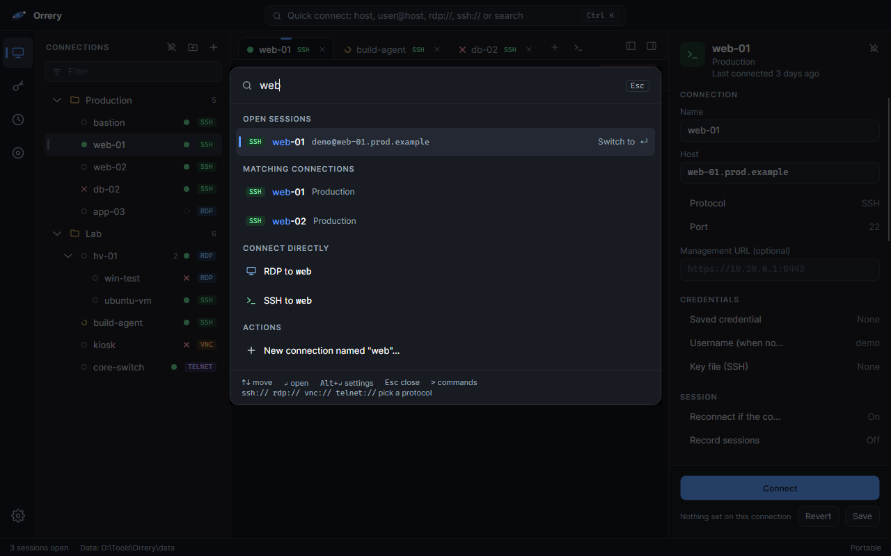
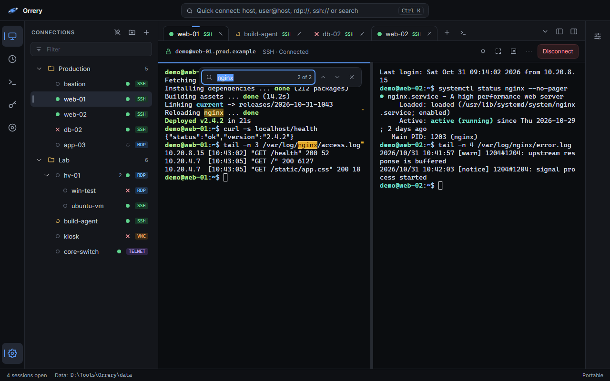
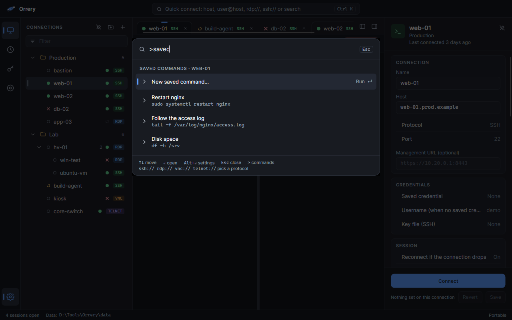
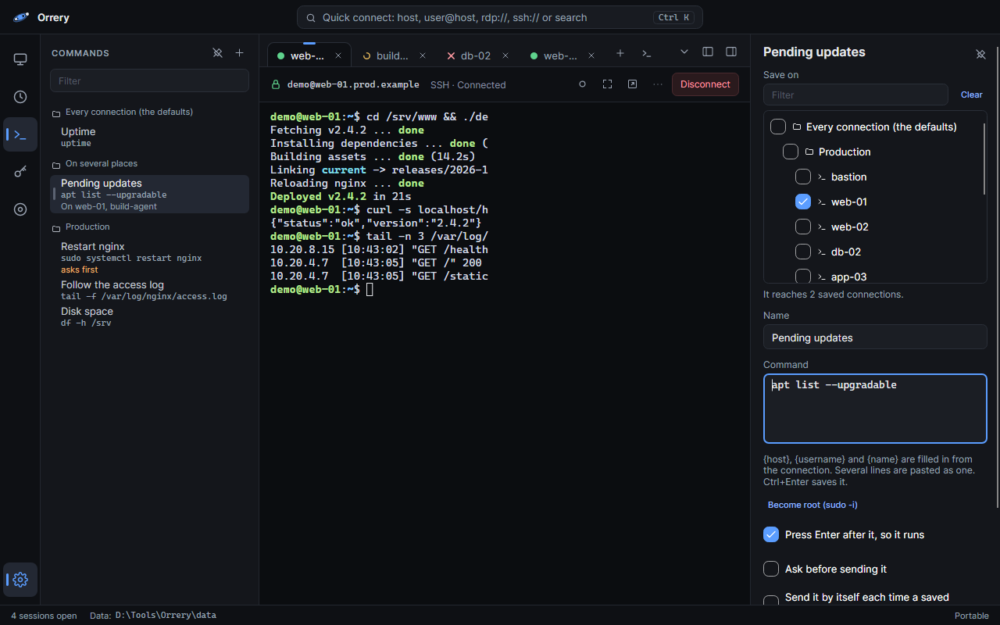
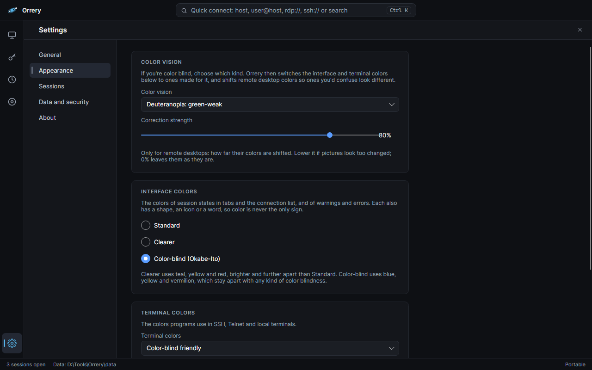
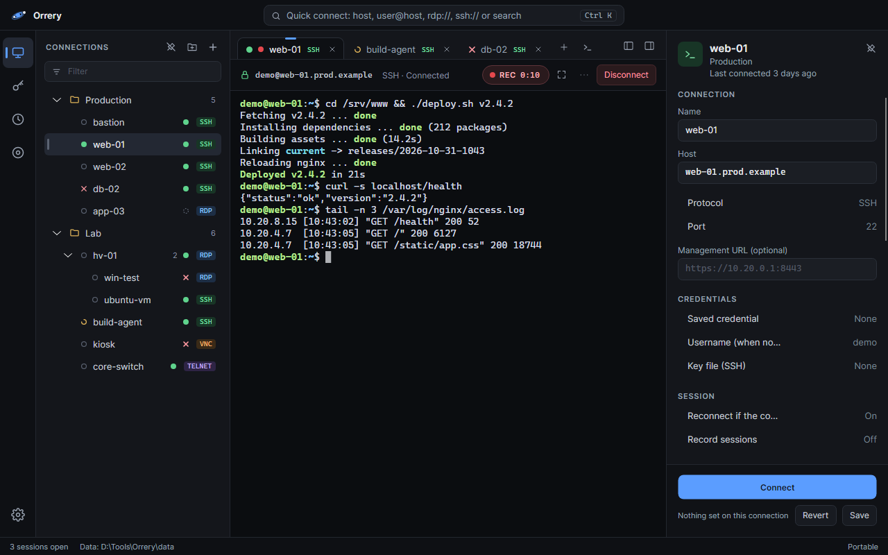
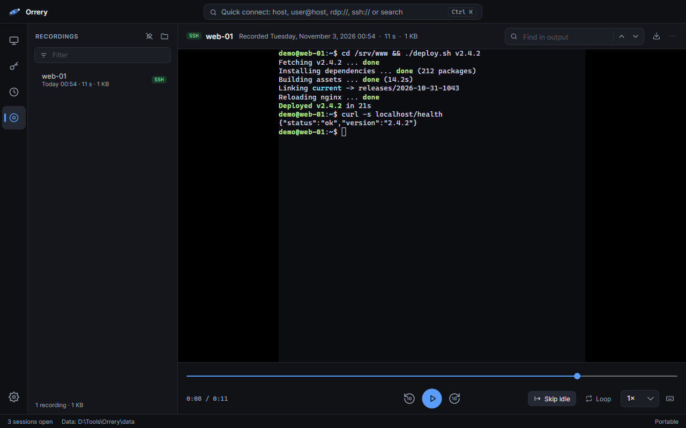
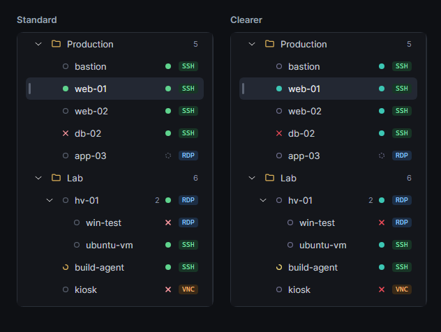

<p align="center">
  
</p>

<h1 align="center">Orrery</h1>

<p align="center">
  A remote connection manager for Windows, Linux and macOS.<br>
  RDP, SSH, VNC, Telnet and serial in one tree, opened in tabs, with passwords in your system's secret store.
</p>

<p align="center">
  <a href="https://github.com/InspireNXE/Orrery/actions/workflows/packages.yml"></a>
  
  
  
  
</p>

<p align="center">
  
</p>

| Runs on | Passwords | Accessibility | Imports |
| --- | --- | --- | --- |
| Windows, Linux and macOS, installed or portable | Credential Manager, macOS Keychain, Secret Service, or an encrypted vault file | Narrator, NVDA and JAWS; colors for color blindness | mRemoteNG `confCons.xml`, `.rdp` files, `~/.ssh/config` |

Orrery is built on Avalonia and .NET 10. It takes its cue from [mRemoteNG](https://mremoteng.org/) and imports its
`confCons.xml`, but isn't affiliated with that project.

> Version 0.1.1. The protocols work, but much hasn't been tried on real machines yet; see [Status](#status).

**Contents:** [Download](#download) · [Platform support](#platform-support) · [Features](#features) · [Accessibility](#accessibility) ·
[Keyboard shortcuts](#keyboard-shortcuts) · [Where your data lives](#where-your-data-lives) · [Building](#building) ·
[Status](#status) · [Security](#security) · [How it's made](#how-its-made) · [License and credits](#license-and-credits)

## Download

From [Releases](https://github.com/InspireNXE/Orrery/releases):

| | Installed | Portable |
| --- | --- | --- |
| Windows | `Orrery-Setup-<version>.exe` (x64) | `Orrery-<version>-win-<x64\|arm64>-portable.zip` |
| Linux | `.deb`, `.rpm`, or the AppImage | `Orrery-<version>-linux-<x64\|arm64>-portable.zip` |
| macOS | | `Orrery-<version>-macos-<arm64\|x64>-portable.zip` (an `Orrery.app`) |

The packages aren't signed yet, so Windows SmartScreen and macOS Gatekeeper will warn the first time
([docs/code-signing.md](docs/code-signing.md) has the plan). Each release lists its files' SHA-256s in `SHA256SUMS`,
and GitHub attests that they were built by this repository's workflow:
`gh attestation verify <file> --repo InspireNXE/Orrery`.

On first launch a short setup asks where a portable copy keeps its data, where saved passwords go (and the vault's
master password, if that's your choice), what to import, and how to handle updates. *Skip to the end* goes straight to the summary, keeping anything you've already chosen.

## Platform support

<table>
<tr><td>✅ Works</td><td>🧪 Built, not yet tried on a real machine</td><td>🔸 Partly, see the note</td><td>🗓️ Planned</td><td>➖ Not possible there</td></tr>
</table>

Orrery is built and used daily on Windows. The macOS and Linux builds pass the same tests but haven't run on a real
machine yet, hence the 🧪.

| | Windows | macOS | Linux (Wayland) |
| --- | :---: | :---: | :---: |
| **Connections** | | | |
| RDP | ✅ | 🧪 | 🧪 |
| SSH, with SFTP, port forwards and SOCKS | ✅ | 🧪 | 🧪 |
| SSH key files and agent keys | 🧪 | 🧪 | 🧪 |
| VNC | ✅ | 🧪 | 🧪 |
| Telnet | ✅ | 🧪 | 🧪 |
| Serial consoles | 🧪 | 🧪 | 🧪 |
| Local terminal, also saved in the tree | ✅ PowerShell, cmd, WSL | 🧪 login shell | 🧪 login shell |
| Local terminal as administrator | 🧪 through UAC | ➖ | ➖ |
| Web pages, in a tab or your browser | ✅ | 🧪 | 🧪 [^webkit] |
| Jump hosts for every protocol | ✅ | 🧪 | 🧪 |
| Quick connect, reconnect, Wake-on-LAN | ✅ | 🧪 | 🧪 |
| Pop a tab out into its own window | 🧪 | 🧪 | 🧪 |
| Two tabs side by side | 🧪 | 🧪 | 🧪 |
| Find in a terminal's scrollback | 🧪 | 🧪 | 🧪 |
| Saved commands on any connections, asking first for risky ones | 🧪 | 🧪 | 🧪 |
| **Remote desktops** | | | |
| Fit the window and follow resizes | ✅ | 🧪 | 🧪 |
| Clipboard | ✅ text, images, files | 🧪 text, images, files [^files] | 🧪 text, images, files [^files] |
| Sound | ✅ | 🧪 | 🧪 |
| Mute a tab | ✅ | 🧪 | 🧪 |
| Shared drives and folders | 🧪 every drive or any folders | 🧪 home or any folders | 🧪 home or any folders |
| Full screen over several displays | 🧪 | ➖ one display [^spaces] | ➖ one display [^wayland] |
| System keys (Windows key, Alt+Tab) sent to the session | ✅ | 🔸 Send keys menu | 🔸 Send keys menu |
| Touch and pen, console session, broker redirection | 🧪 | 🧪 | 🧪 |
| **Recording** | | | |
| Record terminals and remote desktops, with sound | ✅ | 🧪 | 🧪 |
| Record web pages in a tab | ✅ | ➖ | ➖ |
| Play back, with speed, skip idle and Find | ✅ | 🧪 | 🧪 |
| Export `.cast` and `.avi` | 🧪 | 🧪 | 🧪 |
| Export MP4, with sound | 🧪 built in | 🔸 through ffmpeg | 🔸 through ffmpeg |
| MP4 without ffmpeg | ✅ | 🗓️ AVFoundation | ➖ |
| Record the remote pointer's shape | 🗓️ | 🗓️ | 🗓️ |
| **Credentials** | | | |
| System secret store | ✅ Credential Manager | 🧪 Keychain | 🧪 Secret Service |
| Encrypted vault file | ✅ | 🧪 | 🧪 |
| Unlock with biometrics | 🧪 Windows Hello | 🔸 Touch ID, needs a signed build | ➖ |
| **Organizing and import** | | | |
| Tree, folders, inheritance, host status | ✅ | 🧪 | 🧪 |
| Host groups (guests under their host) | ✅ | 🧪 | 🧪 |
| A collapsed host showing its guests' sessions | 🗓️ | 🗓️ | 🗓️ |
| Import mRemoteNG, `.rdp` and `~/.ssh/config`; export | ✅ | 🧪 | 🧪 |
| **Accessibility** | | | |
| Screen readers | ✅ Narrator, NVDA, JAWS | 🧪 VoiceOver | 🧪 Orca [^orca] |
| Color-blind colors and desktop correction | ✅ | 🧪 | 🧪 |
| **Packages** | | | |
| Installer | ✅ | 🔸 app bundle, not signed | 🧪 .deb, .rpm, AppImage |
| Portable | ✅ | 🧪 | 🧪 |
| arm64 | 🧪 | 🧪 Apple Silicon | 🧪 |

[^spaces]: macOS gives each display its own full-screen space.
[^wayland]: Wayland doesn't let a window place itself or span displays. X11 sessions aren't supported.
[^orca]: Avalonia 12 reads to screen readers through AT-SPI, under XWayland. Orca hasn't been tried with Orrery yet.
[^webkit]: Pages in a tab need WebKitGTK (libwebkit2gtk-4.1), which the .deb and .rpm recommend; without it they open in your browser. Like the rest of Orrery's window, they're drawn through XWayland.
[^files]: Remote files download when copied, up to 1 GB, into a private folder removed when the session ends.

Further out: browser access through a tray agent, and scripted connect. See the
[roadmap](docs/roadmap.md).

## Features

### Protocols

| Protocol | Library | Notes |
| --- | --- | --- |
| RDP | [IronRDP](https://github.com/Devolutions/IronRDP) | Follows window resizes or keeps a fixed size; sound; shared drives; full screen over chosen displays (Windows); console session; touch and pen; broker redirection; opens `.rdp` files |
| SSH | [SSH.NET](https://github.com/sshnet/SSH.NET) | Port forwards (`L`, `R`, `D`), a folder-wide SOCKS proxy, key files, agent keys, keep-alives, SFTP browser |
| VNC | [MarcusW.VncClient](https://github.com/MarcusWichelmann/MarcusW.VncClient) | Text clipboard, view only, fill, shrink to fit or actual size |
| Telnet | Built in | |
| Serial | [System.IO.Ports](https://www.nuget.org/packages/System.IO.Ports) | COM ports and `/dev/tty*`, with speed, data bits, parity, stop bits and flow control |
| Web (HTTP, HTTPS) | [Avalonia.Controls.WebView](https://www.nuget.org/packages/Avalonia.Controls.WebView): WebView2, WebKit or WebKitGTK | Keeps admin pages in the tree beside the rest; opens in a tab, or your default browser if you choose |
| Local terminal | Built in | PowerShell, cmd or WSL on Windows; your login shell on Linux and macOS. On Windows, *Local terminal as administrator* asks UAC each time and runs the shell in a tab marked Administrator, through a helper that answers only the Orrery that started it; it isn't reopened at the next start. Save one in the tree as a **LOCAL** connection, with its shell, starting folder and (on Windows) *Run as administrator*, to open it like any other connection, with saved commands and recording; running as administrator isn't taken from an imported file |

### Connecting

<p align="center">
   for commands, and ssh://, rdp://, vnc:// or telnet:// to pick a protocol.">
</p>

Quick connect (Ctrl+K) searches saved connections and open sessions as you type, or connects straight to a host.
It runs commands too: start with `>` to list them all, or type a few words ("disc prod", "copy pass web").

- **Commands** in quick connect: everything in the current session's menu (Send keys, Save as PDF, Start
  recording…), reconnect or disconnect every session, connect or disconnect everything in a folder, and for a saved
  connection edit, wake, open its management page, browse its files, or copy its address or password. A copied
  password is cleared from the clipboard after 30 seconds, and on Windows kept out of clipboard history.

- **Jump hosts** work for every protocol, like `ssh -J`; RDP, VNC and Telnet go through an SSH tunnel. Web pages
  can't, in a tab or the browser: give the jump host a SOCKS proxy instead. The tunnel's port on this computer takes
  only Orrery's own connection, so another user of a shared machine can't ride it.
- **Folders** can give every SSH connection inside a SOCKS proxy (like its own `D 1080`) and a keep-alive interval
  (30 seconds by default; 0 for none).
- **Quick connect** also takes `http://` and `https://` addresses, which open in a tab like other web pages, and serial ports:
  `COM3`, `/dev/ttyUSB0` or `serial://<port>`.
- **`.rdp` files** open from the tree's right-click menu or the command line (`Orrery server.rdp`) without being
  saved; Import adds them to the tree. Saved passwords aren't imported (Windows encrypts them per user and
  computer), so Orrery asks. With Orrery already running, a second start says so; use Open in that window.
- **Ctrl+Alt+End** sends Ctrl+Alt+Del (Ctrl+Cmd+End on macOS). The Send keys menu has it and other keys a remote
  desktop may need; View only stops sending keys and clicks.
- **Touch and pen** pass through RDP, with pressure, tilt and the eraser, when the server takes them.
- **Sound** plays here unless you turn it off, in which case the server isn't asked for any. Windows servers only
  send sound with the drive-sharing channel open, so Orrery opens it, empty, when nothing is shared.
- **Muting:** a tab playing sound shows a speaker, as in a browser. Click it, or *Mute tab* in the tab's menu.
  Recordings still get the sound.
- **Graphics pipeline (RDPGFX)** is used when the server offers it, without H.264, which blurred text. Resizing,
  full screen included, then keeps the session running. Without it, each resize restarts the display. The new size
  is asked for soon after the window stops changing (and every 300 ms during a long drag), and until the server's
  picture at that size arrives, the old one is stretched to fill the window.
- **Shared drives:** every drive, or folders you pick, appear as drives on the remote computer, one each. On Linux
  and macOS, sharing every drive shares your home folder. Orrery says when a folder isn't shared.
- **Full screen** goes where the connection says, under Display › Full screen on: the window's display, every
  display, or ones you pick on a map. On Windows, a remote desktop gets one monitor per display; with a gap (1 and
  3), the remote monitors sit side by side and display 2 keeps showing this computer. VNC stretches across.
  `.rdp` files' `use multimon` and `selectedmonitors` are read, numbered as mstsc numbers them.
- **Console session**, as `mstsc /admin`.
- **RD Connection Broker** redirections are followed (up to five) with the routing token sent back.
- **SSH keys:** a connection or folder can name a key file. Orrery tries a saved key, then the file, then your
  agent, then the password. The file is read on each connect, never copied. Passphrases are asked for and can be
  saved. On Linux and macOS, Orrery warns when others can read the key.
- **SFTP browser** beside the terminal: upload, drop in, download, rename, delete, new folder, copy paths, from the toolbar, keys or a right-click menu.
- **Clipboard** is shared unless turned off for a connection or folder. RDP carries text, images and files; VNC,
  text. On Linux and macOS, remote files download when copied (up to 1 GB), with progress and Cancel at the foot of
  the desktop. Not yet tried on a real Mac or Linux machine.
- **When a connection fails or drops,** the tab says what happened and what to try. Enter reconnects; details are a
  click away, with a Copy button. A remote desktop (RDP or VNC) that isn't connected shows its last picture dimmed,
  so it isn't mistaken for a live one.
- **Reconnects** happen on their own, waiting longer each time (up to a minute), and at once when the network
  returns. A refused login or an untrusted host key or certificate is never retried.
- **Many tabs** narrow to fit the tab strip, as in a browser, then show only their state (the current one keeps its
  close button), and past that the strip scrolls with the mouse wheel. The ⌄ button lists every tab.
- **Pop out** a tab into a window of its own, from its menu, the session toolbar, Ctrl+Shift+O, or by dragging it
  off the tab strip. The window has the session's toolbar and its own full screen. *Back to tabs*, the shortcut
  again, or closing the window puts it back where it was in the strip; dragging the name in its bar onto the tab
  strip puts it back where you let go. It keeps running throughout.
- **Side by side:** two tabs share the session area, from a tab's menu, Ctrl+Shift+E (the current tab and the next),
  or by dragging a tab to the left or right edge of the session area, which shades the half it will take. Drag the
  divider to resize. The side you click or type in is the current tab, with a line over it; choosing another tab
  puts it in that side and leaves the other in view. Closing or popping out either side gives the other the whole
  area, and full screen or the shortcut again ends it. A remote desktop that follows window resizes fits its side.
- **Find** in a terminal (Ctrl+Shift+F, Cmd+F on macOS, or Find… in its right-click menu) searches the screen and
  its scrollback as you type, newest match first. Enter goes back through older ones and Shift+Enter forward;
  matches are marked in the text and as ticks down the scroll bar. Selected text is searched for straight away.
- **Saved commands:** an SSH, Telnet or serial connection, or a folder, can keep commands for its terminals. Ones
  on the defaults for all connections reach every terminal, local shells and quick connects included. Add them in
  the properties pane under Commands, from *Commands › New command…* in the session's menu or Ctrl+K, or with
  *Save selection as command…*. *Save on* ticks where it goes: the terminal's own connection to begin with, and
  any others, folders or the defaults as well. A guest is listed under its host but isn't ticked with it, since it's
  another machine; *+ guests* on the host's row (or Shift+click on its box) ticks it with all its guests, and the
  row says how many are ticked. A ticked folder covers everything in it, guests included, so those rows show ticked
  and grayed out. With a filter typed, *Tick the N shown* ticks every connection it shows; *Clear* unticks
  everything. Saved on several places, a command keeps a linked copy on each, and editing it edits them all (an older
  Orrery reads the copies as separate commands). They're listed under Commands in the session's menu and in Ctrl+K (`>saved` lists them), where Enter
  sends one and Shift+Enter types it without pressing Enter. `{host}`, `{username}` and `{name}`
  are filled in from the connection. A command marked *Ask before sending it* shows what will be sent and to which
  host, with Cancel focused; the editor ticks it for commands that look like they delete, stop or overwrite something, such as
  `rm -rf` or `systemctl stop`. *Confirm every command* asks before all of them, for a connection or a whole
  folder. A command marked *Send it by itself each time a saved connection connects* is typed once the terminal
  connects, reconnects included: the defaults' first, then each folder's inwards, then the connection's own, each
  once the shell's prompt shows. Local shells and quick connects never send anything by themselves. The arrows
  beside a command in the properties pane move it up or down, which is the order the menus list them and the
  order they're sent in when connected.
- **Commands page:** the Commands button in the rail lists every saved command in one place, grouped by where it's
  saved (the defaults first, then those on several places, then folders and connections in tree order), with a
  filter that matches names, text and places. Choosing one opens it in the right-hand pane to edit; ticking or
  unticking places under *Save on* adds it there or takes it off. + adds one, starting on the connection or folder
  selected in the tree. When the current tab is a connected terminal that has the command, *Send to* (its name)
  saves any changes and sends it, asking first if it says to. Right-click a command for Send to, Edit, Duplicate,
  Copy command, Move up and down (for one on a single place), a new command on its place, and Delete (Delete key
  too); right-click a group for a new command there.
- **Becoming root:** a command can answer a password prompt (*If it asks for a password*) with the connection's
  login password or a saved credential's, such as root's for `su -`. *Become root* in the editor fills in `sudo -i`
  answered with the login password. Any program on a server can show a password prompt, so use it only on servers you
  trust; the editor says so, and which connections the password reaches.
  - The password is typed once, only if a password prompt shows within 10 seconds of the command, never at a shell
    prompt and never again if it's refused. It isn't in the command or the logs, which name the credential.
  - Only saved connections get one, never a local shell or a quick connect. The login password goes only to that
    login: not when the session logged in as someone else, nor at a prompt for another user's password.
  - A chosen credential's password is never typed from the defaults for all connections. On a folder, the editor
    warns that every connection in it gets the password when it asks. Over Telnet and serial it says the password
    crosses the line unencrypted.
  - Whatever it didn't do, or did wrong, is said in a bar above the session that stays until you dismiss it. If the
    password shows on screen after it's typed, the prompt wasn't a real one: the bar says so in red, and that the
    password is in the scrollback (and the recording, if there is one), so you can change it.
  - On connect, a command that types a password waits for the shell's prompt and isn't sent without one.
  - A command that asks first says which password it would type, and a vault unlock it brings up says why.
  - Safer where you can: a NOPASSWD sudoers rule or a key for root keeps no sudo password in Orrery.

  Imported commands are listed in the import preview, unticked, and none of them sends itself or types a password
  until you set that.

<p align="center">
  
</p>

<p align="center">
  saved typed in. Under Saved commands · web-01 it lists New saved command…, then Pending updates, Restart nginx, Follow the access log, Disk space and Uptime, each with the command it sends beneath its name.">
</p>

<p align="center">
  
</p>

- **Wake-on-LAN** from the right-click menu, once a connection has a MAC address.
- **Management page:** give a connection a URL, such as a firewall's admin page or an out-of-band console, and
  *Open management page* opens it in a tab. Folders don't pass it on. Web pages go to your default browser instead if you choose that in Settings, or for one connection or folder.
- **Web tabs** have back, forward and reload, and Print and Save as PDF under More. Links meant for a new window open
  in a tab beside the page; a page's own pop-up, such as a sign-in, opens as a pop-up. An untrusted certificate shows
  the engine's warning, with a way past it, and the tab says the page didn't load. The lock before the address is
  closed only for HTTPS (and SSH and RDP); plain HTTP, Telnet and VNC show it open, in amber. A page opens only web
  addresses in new tabs, a few at a time, and Open in browser takes only web addresses. Their sign-ins and cookies
  stay in `web/` in the data folder; Settings > Web pages clears them, and Move data leaves them behind.

<p align="center">
  
</p>

### Organizing

- A tree with folders, drag and drop, multi-select and a filter. Connections inherit settings from their folders.
- Host groups put a host's guest machines under it.
- **Two marks per row.** Before the name, the session: filled dot connected, broken ring connecting, cross failed,
  empty ring none. Beside the protocol, the host: filled dot up, cross down, dashed ring can't be checked. Hover for
  words.
- **Host checks** run about once a minute, only for visible connections and never through a jump host. They're a
  plain TCP connect by default, which some networks treat as a port scan; Settings can switch to ping or turn them
  off. Firewalls often block ping, so up hosts may show as down; without ping rights, hosts show the dashed ring.
  Serial ports aren't checked; web pages are checked at their host and port. A folder or connection can turn its
  checks off, and an import asks first whether to check the hosts it adds.
- **Properties pane:** one line per setting. A blue dot marks values set here; muted ones are inherited. Click to
  change, or "Use that instead" to inherit again. The footer counts what's set here.
- **This session tab:** while a remote desktop is open, Scaling, View only and Color correction change it at once,
  until it closes; Keep for next time saves the change. Settings that need a reconnect are listed with a Reconnect
  button.
- **Pane layouts** (Settings › General, or the pin in each pane's header), for the side panel and the properties
  pane: Pinned docks it; Over the session leaves a strip and opens over the sessions; Hidden leaves no strip (the
  window's edge or the shortcut brings it back). A pane opened over a session doesn't resize the remote desktop; on
  Linux and macOS it opens beside a web page, since nothing can be drawn over the page there. Drag a pane's inner edge to resize it. Panes start the way
  they were left: their widths, a pinned pane put away with its shortcut stays away, and the side panel opens on
  Recent or Commands if that's where it was (Credentials and Recordings start on Connections).
- **Last connected** shows in the properties pane ("3 days ago", exact time on hover), with a newer failed attempt
  if there was one.

### Credentials, import and export

- Passwords go in Windows Credential Manager, the macOS Keychain or the Linux Secret Service, or an encrypted vault
  file (Argon2id, XChaCha20-Poly1305) where there's no store or you prefer one.
- Windows Hello can unlock the vault when its key is held in the TPM (not over Remote Desktop). When it's on, the
  unlock window asks Windows Hello first and shows the master password field only if that's canceled or fails. If Windows keeps
  Hello's keys in software, usually because the PIN was set up while the TPM couldn't be used, turning it on is
  refused with how to fix it (remove the PIN in Sign-in options and add it again), and the setup window says so up
  front the next time in that run. Touch ID is written
  but needs a signed build. See [the design notes](docs/design-biometric-unlock.md).
- **Import:** mRemoteNG `confCons.xml`, Orrery `.json`, `.rdp` files, and `~/.ssh/config` with `Include` files,
  `Host *` defaults and `ProxyJump` chains (as jump hosts). Nothing in an SSH config runs, and key files aren't
  opened. The preview names every connection that shares drives or folders, or opens a port forward or proxy beyond
  this computer, so a file from someone else can't set those up unseen.
- **Export:** Orrery `.json`, mRemoteNG `confCons.xml` or CSV. Passwords are encrypted under a password you choose,
  at least 12 characters and not a common one (as for a new vault); `confCons.xml` uses 50,000 key rounds, the most
  mRemoteNG offers. CSV never gets them. Serial connections are left out of `confCons.xml`, which has none, and the export says so.
- The credential editor hides a private key until you press Show; pasting still works.

### Display and color

- **Display quality** per connection or folder: Balanced, Best look or Fastest.
- **Enlarge to match display scaling** (on by default): RDP tells the server your scaling, as Windows' client does,
  so it draws at full resolution with text sized like your local apps. VNC can't be told, so its picture is enlarged
  here. Off, one remote pixel is one screen pixel.
- **Scaling** for a desktop that doesn't match its tab: *Fit the tab* (default), *Shrink to fit*, or *Actual size*
  with scroll bars.
- **Interface colors:** Standard, Clearer (easier to tell apart for most color blindness) and Color-blind
  (Okabe-Ito). The terminal has its own color-blind scheme.
- **Color vision:** pick protanopia, deuteranopia or tritanopia, and Orrery switches to color-blind colors, tunes the
  terminal, and shifts the colors you'd confuse in RDP, VNC and web pages, at a strength you pick. A connection or
  folder can turn that off for design or photo work.
- Session states, host status, warnings and errors each have a shape, icon or word as well as a color.
- HDR isn't possible over RDP or VNC.

<p align="center">
  
</p>

### Recording sessions

<p align="center">
  
</p>

- **What's recorded:** what a terminal printed, or what a remote desktop showed, at up to 60
  frames a second, taken only when the screen changes, with RDP sound. On Windows, a web page in a tab is recorded
  the same way, from the engine's own picture of the page (no sound); WebKit on Linux and macOS can't give one.
- **What's typed,** only if you turn on *Record what's typed too* (off by default, terminals only). Keys and pastes
  go in; passwords Orrery types for you and typing at a password prompt it recognizes don't, and a marker shows
  where typing was left out. A password typed at any other prompt, or pasted, **is** kept, and anyone who can open
  the recording can read it. While it's on, the tab and full-screen bar say *Recording, typing too*, and the player
  shows the typed line under the terminal.
- **Starting:** the *Record sessions* setting (inherited, so a folder can record everything in it), *Record every
  session* in Settings, or the tab's menu. A red dot on the tab and a *REC* pill show it's on, and in full screen the
  bar at the top says *Recording*; the pill changes the frame rate and sound, or stops. A reconnect carries on in the same file.
- **Encrypted,** sealed to a key kept with your saved credentials: recording never asks for the vault, playing does,
  and locking the vault closes the player. Recordings live in `recordings/` in the data folder, readable only by
  you; old ones are deleted by age and total size.
- **Playback** in the *Recordings* panel: ½× to 8×, sound at its pitch up to 4×, Skip idle, Loop, 10-second skips,
  markers for drops and reconnects, volume, Find for terminals with its matches on the timeline, keyboard shortcuts
  (? lists them), and your color correction.
- **Export** an unencrypted copy: `.cast` for asciinema (with what was typed as input events, if it was kept), Motion-JPEG `.avi`, or MP4 (H.264, H.265 or AV1). On
  Windows, MP4 uses Windows' own encoders; elsewhere, or for a codec Windows lacks, it uses an ffmpeg you've chosen
  in Settings, which finds one installed by the usual package managers and shows the codecs each route offers.
  Orrery never downloads or bundles ffmpeg; *Get ffmpeg* in Settings links to its download page, with the install
  command for your system. See
  [the design notes](docs/design-session-recording.md).

<p align="center">
  
</p>

### Your workspace

- Install it, or run it portable with its data wherever you choose.
- Updates come from this repository's releases. Orrery checks as it starts and then every hour while it's open
  (30 minutes to a day in Settings › About › Updates, or Ctrl+K *Check for updates* any time), sending only its
  version, and shows a bar above the tabs when one is out. *What's new*, there or in Ctrl+K, shows the release
  notes of your version and the ones around it. Windows
  copies and the AppImage download it, check it against the release's `SHA256SUMS`, and restart as the new version,
  reopening the sessions that were open; *When I quit* waits instead. The .deb, .rpm and macOS copies point you to
  the release. Later, Skip this version, previews and downloading in the background are in Settings. A preview
  copy is offered the next preview unless you turn previews off.
- Orrery remembers the window and open tabs and can reopen them at start: ask, always or never. A popped-out tab
  comes back in its own window, where it was. Quick-connect hosts come back by address and ask for their login again. Never also stops saving the tab list and deletes the saved
  one; window size, position and panes are still kept.
- Turning off *Remember recent connections* deletes the Recent list and last-connected times, and records nothing
  until it's back on.
- Dark first.

## Accessibility

Orrery aims to work with a screen reader, from the keyboard, and with color blindness. Known gaps are at the end.

### Screen readers

Narrator, NVDA and JAWS on Windows.

- Every button, field and list says what it is.
- Tree rows give their name, what they are (protocol and host, or a folder's count), session state, and whether the
  host is up.
- Session tabs give their connection, state, and which is current.
- When a connection fails or drops, you hear why and the focus moves to Reconnect.
- Prompts to trust a new host key or certificate take the focus and are read out.
- Terminals read new output a few lines at a time once it pauses, without echoing your typing. On while a screen
  reader runs; change it under Settings › Appearance › Accessibility. The whole screen and the cursor's position can
  be read too.
- Password fields give a dot per character, never the password. The private key box says only "Private key, 3
  lines".

### Keyboard

- Terminals and remote desktops keep every key, Tab included.
- Ctrl+Alt+Home (Ctrl+Cmd+Home on macOS) leaves the session for its tab, leaving full screen first; Enter goes back.
- In a terminal, Ctrl+Shift+A selects all; plain Ctrl+A still reaches the shell.
- In every prompt, Enter is the default button and Esc cancels, and Left and Right move between the buttons. A
  prompt opens with its field or default button focused; where Enter is unsafe, that's Cancel. In a box that takes
  several lines, such as a saved command, Ctrl+Enter (Cmd+Enter on macOS) saves.

### Color

- See [Display and color](#display-and-color) for the color sets, terminal scheme and desktop correction.
- Tests check every meaningful color against simulated protanopia, deuteranopia and tritanopia (Machado et al.
  2009) for distance (CIEDE2000), and against WCAG contrast.

<p align="center">
  
</p>

### Not there yet

- A remote desktop is a picture: a screen reader hears only "Remote desktop:" and the connection's name.
- Color correction separates confusable colors but can't show ones you can't see, and changes how pictures look.
  It's been checked by numbers, not yet by color-blind people.
- Avalonia doesn't let screen readers move through a terminal by line or word yet; they get one block of text.
- Tree rows don't report their level or "2 of 5". Password fields aren't marked as such, so a reader that echoes
  typing will read a password aloud; turn that echo off while typing one.
- VoiceOver is untested. On Linux, Avalonia 12 reads to screen readers through AT-SPI, but Orca hasn't been tried
  with Orrery yet.

## Keyboard shortcuts

On macOS, Cmd takes the place of Ctrl.

| Keys | Action |
| --- | --- |
| Ctrl+K | Quick connect; `>` for commands. From a terminal, where Ctrl+K is the shell's, Ctrl+Shift+K |
| Ctrl+Shift+T | Local terminal |
| Ctrl+Shift+O | Pop the tab out into its own window, or put it back |
| Ctrl+Shift+E | Show the tab side by side with the next, or end side by side |
| Ctrl+Shift+F (Cmd+F on macOS) | In a terminal: find in the scrollback |
| Ctrl+Shift+A, Ctrl+Shift+C, Ctrl+Shift+V (Cmd+A, Cmd+C, Cmd+V on macOS) | In a terminal: select all, copy, paste |
| Ctrl+, | Settings |
| Ctrl+B | Show or hide the side panel, over the sessions unless it's pinned; the mode stays as it is |
| Ctrl+Alt+B | Show or hide the properties pane, the same way. On Windows layouts where AltGr+B types a character, such as `{` on Czech, the character goes to the session instead |
| Ctrl+Alt+Enter (Ctrl+Cmd+F on macOS) | Full screen (changeable in Settings) |
| Ctrl+Alt+Home (Ctrl+Cmd+Home on macOS) | Leave the session for its tab; Enter goes back |
| Ctrl+Alt+End (Ctrl+Cmd+End on macOS) | In a remote desktop: send Ctrl+Alt+Del |
| Enter | Connect the selected connections |
| F2 | Rename |
| Ctrl+D | Duplicate |
| Delete | Delete the selected rows |

A focused remote session gets keys first, so these go to the remote machine. Full screen, Ctrl+Alt+Home and
Ctrl+Alt+End always reach Orrery. Ctrl+Shift+T, Ctrl+Shift+O, Ctrl+Shift+E and Ctrl+Shift+K work from a terminal,
not from a remote desktop.

## Where your data lives

A portable copy has `orrery.portable.json` beside the executable and asks on first launch where to keep its data.
An installed copy uses each system's usual folder.

<details>
<summary>Data folders for an installed copy</summary>

| | Installed copy |
| --- | --- |
| Windows | `%APPDATA%\Orrery` (cache and logs in `%LOCALAPPDATA%\Orrery`) |
| macOS | `~/Library/Application Support/Orrery` |
| Linux | `~/.config/orrery` (XDG directories are respected), for the .deb, .rpm and AppImage |

</details>

`history.json` keeps when each connection last connected or failed, by connection, so it survives renames and
moves. It stays on this computer: exports leave it out, and deleting a connection deletes its entry.

Recordings are in `recordings/` in the data folder, encrypted. Move data takes them along.

<details>
<summary>Logs</summary>

One file a day (a new one past 10 MB), in `%LOCALAPPDATA%\Orrery\Logs`, `~/Library/Logs/Orrery` or
`~/.local/state/orrery/logs` (portable: the data folder). They're kept for 14 days and to 100 MB in all; Settings
can keep them for 7 or 30 days instead, and deletes them on request. They record what connected and what went
wrong, never passwords, keys, keystrokes or screen contents. Settings opens the folder, and has a detailed logging
switch that turns itself off when Orrery closes.

Names and addresses are hidden, so a log can go in a GitHub issue as it is. Hosts, IP and web addresses, usernames,
connection and credential names and file paths are written as tags such as `host-3f9a2c` or `path-0c4e1d.orrec`.
The same name always gets the same tag, so a log still shows that two lines are about one server. Tags are keyed by a
secret in the data folder that never goes in a log, so they can't be turned back by trying addresses; Settings looks a
tag up on your own computer. Versions, protocols, ports, error codes, timings and host key fingerprints stay. *Show
names and addresses in logs* writes them out for reading a log yourself, until Orrery closes, and says so in the log.

Hiding works on what Orrery knows is a name, plus anything shaped like an address. A library's error message can
still name a host Orrery hadn't seen yet, so skim a log before you share it. Logs from before 0.1.2 aren't hidden;
*Delete logs* clears them. IronRDP's own log, `ironrdp.log`, is only written when you turn it on with
`IRONRDP_LOG`, and isn't hidden.

</details>

## Building

You need the [.NET 10 SDK](https://dotnet.microsoft.com/download) and PowerShell (5.1 on Windows, or
[PowerShell 7](https://github.com/PowerShell/PowerShell) on Linux and macOS). From the repo root:

```powershell
./build/Get-IronRdp.ps1
dotnet build Orrery.sln
dotnet test Orrery.sln
dotnet run --project src/Orrery.App
```

### The IronRDP package

Several RDP features (the Linux and macOS clipboard, sound, shared drives, the console session, spanning displays,
broker routing) need unreleased changes to IronRDP's .NET binding. Until they ship, Orrery uses a
`Devolutions.IronRdp` built from a fork, at the `IronRdpVersion` in `Directory.Build.props`. It isn't on nuget.org:
`build/Get-IronRdp.ps1` downloads it from the fork's releases into `.nuget-local` (git-ignored), and refuses a file
whose SHA-256 doesn't match `build/ironrdp-package.json`. A restore failing with NU1301 or NU1101 for
`ironrdp-local` means the script hasn't run yet. Run it again only when `IronRdpVersion` changes.

<details>
<summary>Using a package you built, or going back to the released one</summary>

For your own build: `./build/Get-IronRdp.ps1 -FromFolder <folder> -Sha256 <hash>`. Its content hash differs from the
lock files', so locked restores fail until `./build/Update-IronRdpLockHashes.ps1` updates it (checking nothing else
changed). The published package is built for all six platforms by the fork's own workflow; see
[docs/packaging.md](docs/packaging.md).

To return to the released package, remove the `ironrdp-local` source and its mapping from `nuget.config`, set
`IronRdpVersion` to `2026.10.29`, and run `dotnet restore Orrery.sln --force-evaluate`.

</details>

### Packages

To build everything this machine can:

```powershell
./build/Build-All.ps1
```

It runs the scripts below, skipping (with a warning) any whose tools are missing, then lists what it built. Windows
builds everything but the AppImage. `-NfpmPath` and `-IsccPath` point at tools not on PATH; `-SkipPortable`,
`-SkipInstaller` and `-SkipLinux` leave steps out.

<details>
<summary>What each script builds, and what it needs</summary>

| Script | Builds | Needs |
| --- | --- | --- |
| `./build/package.ps1` | Portable zips for win-x64, win-arm64, linux-x64, linux-arm64, macos-arm64 and macos-x64 (`-Runtimes win-x64` for one; .NET calls the Mac ones `osx-arm64` and `osx-x64`) | .NET SDK |
| `build\Build-Installer.ps1` | Windows installer | Windows, [Inno Setup](https://jrsoftware.org/isinfo.php) 7 |
| `./build/Build-LinuxPackages.ps1` | .deb and .rpm, x64 and arm64 | [nfpm](https://nfpm.goreleaser.com/install/) (runs on Windows too) |
| | AppImage, x64 and arm64 | Linux, [appimagetool](https://github.com/AppImage/appimagetool/releases) |

</details>

Packages are self-contained; no .NET needed on the target. Output goes to `artifacts/`. On Windows and Linux the
portable app is one executable that unpacks its native libraries to a cache folder on first run. On macOS it's an
`Orrery.app` bundle, not yet signed or notarized. On Linux, `chmod +x Orrery` after unzipping; the machine needs what
[Linux](#linux-wayland-only) lists, which the .deb and .rpm pull in. No Flatpak.

GitHub Actions builds all of these on every push and pull request. Pushing a `v<version>` tag also makes a draft
release with every package, `SHA256SUMS` and attestations; `build/New-TestRelease.ps1` makes one locally for trying
updates. [docs/packaging.md](docs/packaging.md) covers Linux requirements, third-party notices, lock files, the
workflow, releasing and testing updates.

### Screenshots

`tools/Orrery.Screenshots` draws this README's screenshots from made-up data:
`dotnet run --project tools/Orrery.Screenshots`. See [docs/screenshots.md](docs/screenshots.md).

### Repository layout

<details>
<summary>What's in each folder</summary>

| Path | What's in it |
| --- | --- |
| `src/Orrery.App` | The Avalonia app: windows, connection tree, properties pane, settings |
| `src/Orrery.Core` | Model, storage, credentials, vault, import and export |
| `src/Orrery.Protocols.*` | RDP, SSH, VNC, Telnet and serial sessions, and local terminals |
| `tests/` | xUnit tests, including headless Avalonia UI tests |
| `tools/Orrery.Screenshots` | Draws the README's screenshots from made-up data |
| `build/` | Packaging, installer and third-party notice scripts |
| `installer/` | Inno Setup script for Windows; `installer/linux/` has the Linux launcher and icons |
| `docs/` | Design notes, the packaging guide, and the README's images in `docs/images` |
| `.github/` | The GitHub Actions workflow that builds the packages |

</details>

## Status

On Windows, RDP resizing, the clipboard and the installer work. The RDP clipboard Linux and macOS use was tested for
text against Windows Server 2019; its images and files haven't met a real server yet. Below: what each system needs,
what differs there, and what's untried.

### Every platform

IronRDP versions needed: `2026.10.29-orrery.3` for sound, shared drives, the console session, spanning displays and
the routing token; `orrery.4` for sound without shared drives; `orrery.6` for the graphics pipeline and display
scaling; `orrery.7` for recording sound; `orrery.8` for tab muting; `orrery.9` for clipboard files off Windows;
`orrery.10` for several shared folders off Windows. With a package built on one machine, whose other platforms'
libraries are older, Orrery connects without the missing features and logs which. IronRDP is built without Opus (it needs CMake), so servers send PCM, ADPCM or G.711 (or AAC,
on Windows).

Not yet checked on real machines:

- VNC authentication
- SSH key files, with and without a passphrase: direct, in the file browser and through a jump host
- How each protocol reports real network failures (an RDP server refusing a login, especially)
- RDP touch and pen
- A real RD Connection Broker farm (tested against made-up redirections)
- RDP shared drives and the console session
- A serial console on real hardware (tested against a stand-in port)
- SSH keep-alives and a folder's SOCKS proxy against a real server
- `.rdp` files saved by Remote Desktop Connection itself (tested against files matching its format)
- Recording exports (AVI, MP4) in other players

### Windows

- **Needs:** nothing; packages are self-contained.
- **Keys:** while a session has the keyboard, Orrery takes the Windows keys for it, as mstsc does. Windows keeps
  Ctrl+Alt+Del, so Ctrl+Alt+End sends it.
- **Shared drives:** every drive, or any folders, each as its own drive.
- **Full screen** spans every display or chosen ones, gaps included.
- **Sound** can also come as AAC.
- **Not yet checked:** full screen over several displays, especially with mixed scaling; the Windows Hello prompt;
  the local terminal as administrator; the win-arm64 build.
- Executables aren't code-signed, so SmartScreen may warn on first launch, and antivirus may flag the single-file
  executable.

### macOS

- **Needs:** nothing. The app isn't signed or notarized, so Gatekeeper asks on first launch. Serial ports are
  `/dev/cu.*` and `/dev/tty.*`.
- **Keys:** Cmd+Tab, Cmd+Space and other macOS shortcuts stay with macOS. The Send keys menu sends Alt+Tab, the
  Windows key and the rest.
- **Shared drives:** your home folder when sharing every drive, or any folders, each as its own drive.
- **Full screen** is on one display, since macOS gives each its own space. A connection can pick which; Orrery says
  so when it's set to several.
- **RDP clipboard:** text, images and files. Remote files download when copied (up to 1 GB), not when pasted.
- **Not yet checked:** all of it on a real Mac, including local terminals, the RDP clipboard, Touch ID (needs a
  signed build) and VoiceOver.

### Linux (Wayland only)

Wayland sessions only. Avalonia 12.1's Wayland backend is experimental, so Orrery runs under XWayland, but it has no
X11-specific code. X11 sessions aren't supported.

- **Needs:** XWayland, fontconfig and ICU, which most desktops have. The ALSA library (`libasound.so.2`, from
  `libasound2t64` or `libasound2` on Debian and Ubuntu, `alsa-lib` on Fedora): IronRDP links it, so RDP can't connect
  without it. The .deb and .rpm pull these in; the portable zip and AppImage don't. For the system keyring,
  libsecret and a Secret Service (GNOME Keyring or KWallet); otherwise, or when portable, the vault file is used.
  For serial ports, your user must be in `dialout` (`uucp` on Arch); log out and back in after adding it.
- **Keys:** Super, Alt+Tab and other desktop shortcuts stay with the desktop. The Send keys menu sends them.
- **Shared drives:** your home folder when sharing every drive, or any folders, each as its own drive.
- **Full screen** is on the window's display: Wayland doesn't let windows place themselves or span displays. Orrery
  says so when a connection is set to several.
- **RDP clipboard:** text, images and files. Remote files download when copied (up to 1 GB), not when pasted.
- **Screen readers:** Avalonia 12 reads to screen readers through AT-SPI, but Orca hasn't been tried with Orrery yet.
- **Not yet checked:** all of it on a real machine: the .deb, .rpm and AppImage, arm64, local terminals, the RDP
  clipboard, sound, a serial device and the Secret Service.

## Security

Report a vulnerability privately; see [SECURITY.md](SECURITY.md). Two audits so far, with their fixes:
[October 2026](docs/audit/2026-10) and [November 2026](docs/audit/2026-11), which covered web tabs, recording, the RDP
clipboard and shared folders, imports and the build.

## How it's made

Orrery is built with AI assistance. Its code, tests and documentation are written with
[Claude Code](https://claude.com/claude-code), Anthropic's coding agent, under the maintainer's direction: they
decide what goes in and try it out. Every commit says so with a `Co-Authored-By: Claude`
trailer. The security audits above were run the same way.

## Disclaimer

Orrery is provided as is, without warranty of any kind, as the [MIT license](LICENSE) says: use it at your own risk.
The authors aren't liable for any damage, data loss or security breach that comes from using it.

- **It acts for you.** It connects with the logins you save, sends the commands you save (by themselves on connect,
  if you set that) and types passwords at prompts when a command is set to. Check what a command does, where it's
  saved and which connections that reaches before turning those on.
- **Use it only where you're allowed to.** You're responsible for having permission to reach the servers and desktops
  you connect to, and for what's done on them through Orrery.
- **Keep your own backups.** The vault can't be opened without its master password, and nothing can recover it.
  Recordings and the connection tree are files you should back up as you would any other.
- **Its safeguards reduce risk; they don't remove it.** Host-key checks, the encrypted vault and the checks around
  typed passwords are there to catch mistakes and some attacks, not to make an untrusted or compromised server safe
  to use.
- **It's built with AI assistance** (see [How it's made](#how-its-made)), reviewed and tried by the maintainer, and
  still a preview: expect bugs, and report security issues as [SECURITY.md](SECURITY.md) says.

## License and credits

Orrery is MIT-licensed, © 2026 InspireNXE. See [LICENSE](LICENSE).

Built on open-source work, all under permissive licenses (MIT, Apache 2.0, BSD, ISC, OFL):

- [Avalonia](https://avaloniaui.net/) (UI), [SkiaSharp](https://github.com/mono/SkiaSharp) and
  [HarfBuzzSharp](https://github.com/mono/SkiaSharp) (drawing and text), and the [Inter](https://rsms.me/inter/) font
- [IronRDP](https://github.com/Devolutions/IronRDP) by Devolutions (RDP), [SSH.NET](https://github.com/sshnet/SSH.NET)
  (SSH), [MarcusW.VncClient](https://github.com/MarcusWichelmann/MarcusW.VncClient) (VNC, through the
  [community fork](https://github.com/karbonbaron/MarcusW.VncClient))
- [NSec](https://nsec.rocks/) and [libsodium](https://libsodium.org/) (vault and export encryption),
  [BouncyCastle](https://www.bouncycastle.org/) (mRemoteNG file encryption)
- [Markdig](https://github.com/xoofx/markdig) by Alexandre Mutel (release notes)
- [.NET](https://dotnet.microsoft.com/) by Microsoft and the .NET Foundation, which ships inside every package
- Portions of this software are copyright © The FreeType Project (https://freetype.org). All rights reserved.
  (FreeType is built into Skia.)

Every package carries `THIRD-PARTY-NOTICES.txt`, generated from what that build ships, with each component's license
and copyright notices. The AppImage also carries `APPIMAGE-RUNTIME-NOTICES.txt` for the AppImage runtime and the
libraries linked into it, including libfuse (LGPL 2.1).

mRemoteNG is GPL-licensed. Orrery reads and writes `confCons.xml` with code written from the file format alone, and
contains none of mRemoteNG's code.
